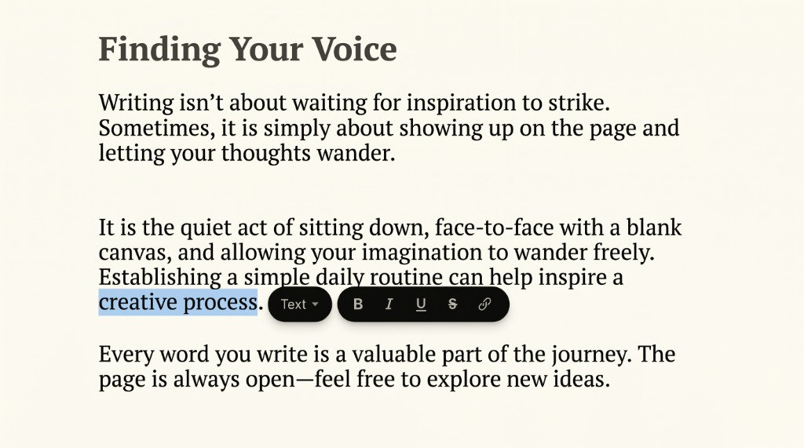
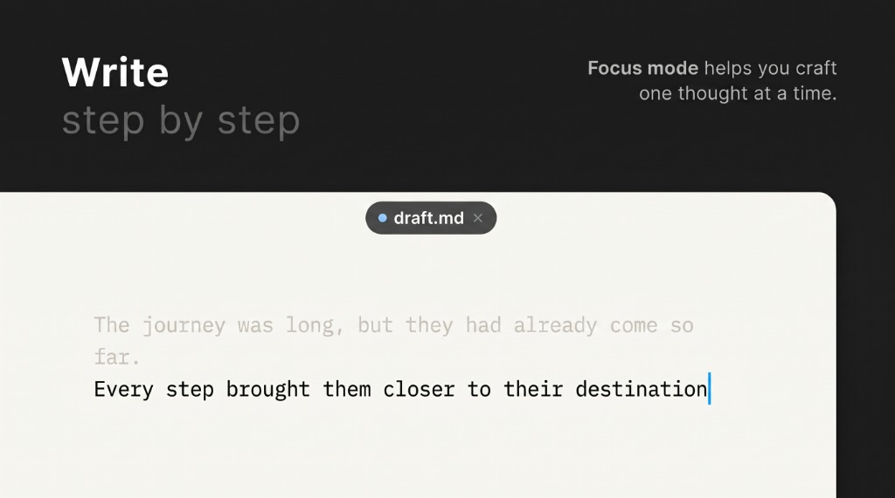
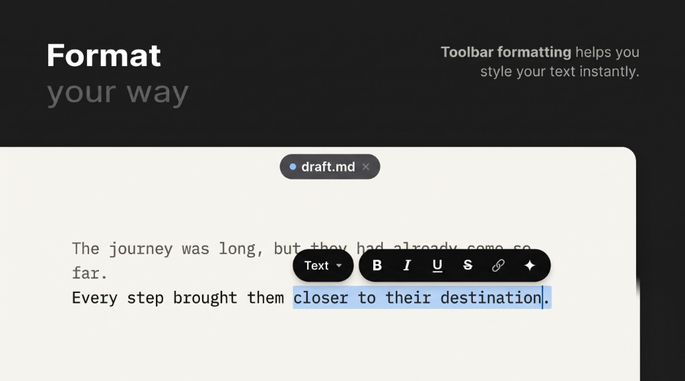
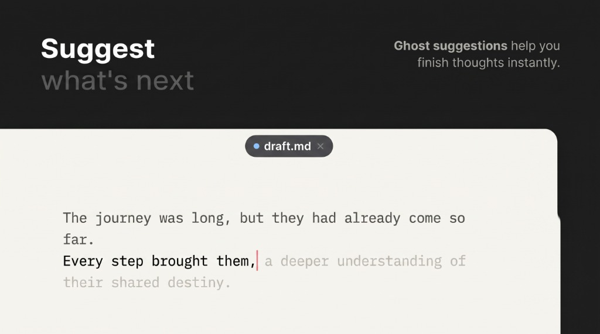
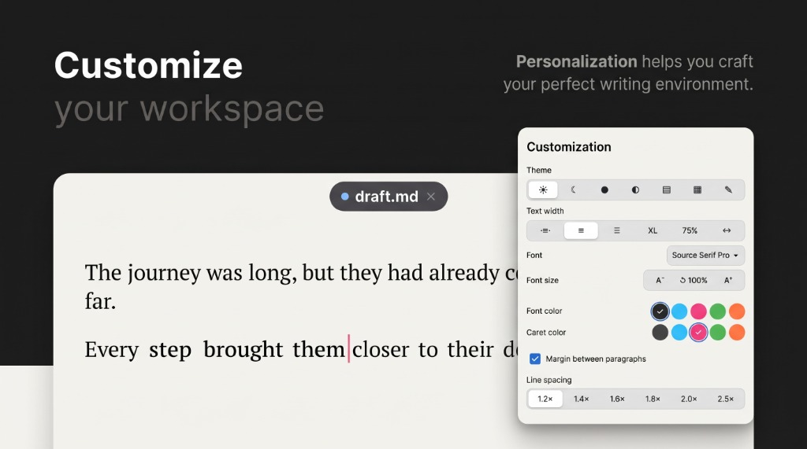

# Sillpaper

**A quiet space for your words.**

A lightweight, native Linux writing app built with Rust, GTK4, and Libadwaita. Enjoy distraction-free rich-text editing, customizable typography, focus and typewriter modes, and flexible document exports.

*No Electron. No WebView. No unnecessary distractions.*



[Installation](#installation) · [Features](#features) · [Screenshots](#screenshots) · [Extensions](#extensions) · [Formats](#file-formats) · [Performance](#performance)

---

## Why Sillpaper?

Writing should feel effortless. Sillpaper combines the simplicity of a distraction-free editor with the flexibility of a full-featured writing tool.

- **Stay focused.** A centered writing canvas, auto-hiding controls, Focus Mode, and Typewriter Mode.
- **Format naturally.** WYSIWYG editing with a floating toolbar, Markdown shortcuts, headings, lists, links, images, and comments.
- **Make it yours.** Customize themes, fonts, colors, writing width, line spacing, and zoom.
- **Keep your work safe.** Atomic autosave, crash recovery, multiple tabs, and external file-change detection.
- **Lightweight and private.** Native Rust and GTK4, offline by default, with optional AI assistance through extensions.

## Screenshots

| Focus Mode | Floating Formatting Toolbar |
| --- | --- |
|  |  |
| **Optional Ghost Suggestions** | **Workspace Customization** |
|  |  |

## Features

### Writing & Editing

- Floating rich-text toolbar with headings, inline formatting, links, lists, and blockquotes.
- Markdown typing shortcuts, smart punctuation, interactive checkboxes, and inline images.
- Focus Mode with adjustable dimming and Typewriter Mode with centered cursor tracking.
- Full undo/redo, Unicode support, automatic text direction, and RTL/LTR controls.
- Multi-tab and multi-window editing, document outline, live word counts, and writing goals.
- Automatic draft recovery and external file-change handling.

### Appearance

- Seven themes, including light, dark, true black, sepia, and custom colors.
- System fonts, adjustable typography, writing widths, spacing, zoom, and caret colors.
- Selectable GSK renderer: Auto, Vulkan, or Cairo.

### Extensions

Optional extensions add functionality without making it part of the core writing experience, including AI-powered Ghost Suggestions.

## File Formats

Sillpaper uses a structured document model to preserve rich formatting across supported formats.

| Format     | Open |                   Save / Export                  |
| ---------- | :--: | :----------------------------------------------: |
| HTML       |  Yes |      Rich HTML5 with styling and RTL support     |
| Markdown   |  Yes |      CommonMark/GFM with extended formatting     |
| Plain Text |  Yes |       Clean text with readable list markers      |
| DOCX       |  Yes | Native Rust OOXML with images, comments, and RTL |
| PDF        |   —  |  Cairo/Pango typesetting, links, and pagination  |
| Print      |   —  |             Native GTK4 print portal             |

## Performance

Built to stay responsive without an embedded browser engine.

Measured on Arch Linux / Wayland, release build, Cairo renderer:

| Metric                  |       Result |
| ----------------------- | -----------: |
| Stripped executable     |   **2.4 MB** |
| Memory usage (PSS)      | **~47 MiB** |
| Idle CPU                |    **0.00%** |
| GPU memory (DRM, Cairo) |    **0 MiB** |
| Processes / threads     |    **1 / 6** |

**50,000-word document benchmark:**

- Document initialization and stats: **2.33 ms**
- Unicode search (3,060 matches): **4.99 ms**
- Internal editing operation: **5.28 µs / keystroke**
- DOCX export / import: **4.80 / 1.72 ms**

These are engine benchmarks, not end-to-end UI latency measurements.

Reproduce with:

```bash
cargo run --release --example bench
```

## Keyboard Shortcuts

Hold `Ctrl` for 1.2 seconds to display the shortcut reference inside the editor.

| Action                    | Shortcut                       |
| ------------------------- | ------------------------------ |
| New / Open / Save         | `Ctrl+N` / `Ctrl+O` / `Ctrl+S` |
| Bold / Italic / Underline | `Ctrl+B` / `Ctrl+I` / `Ctrl+U` |
| Insert link               | `Ctrl+K`                       |
| Find                      | `Ctrl+F`                       |
| Focus Mode                | `Ctrl+M`                       |
| Typewriter Mode           | `Ctrl+Shift+T`                 |
| Print                     | `Ctrl+P`                       |
| Settings                  | `Ctrl+,`                       |

Other shortcuts are available through the in-app reference.

## Installation

Download a package from [GitHub Releases](https://github.com/ubaimutl/sillpaper/releases/latest). Choose `amd64` / `x86_64` for 64-bit Intel or AMD, or `arm64` / `aarch64` for ARM64. The commands below use the x86-64 files from v0.1.1.

**Ubuntu / Debian (`.deb`)**

```bash
sudo apt install ./sillpaper_0.1.1_amd64.deb
```

**Fedora (`.rpm`)**

```bash
sudo dnf install ./sillpaper-0.1.1-1.x86_64.rpm
```

**Portable archive (`.tar.gz`)**

The prebuilt archive needs a compatible Linux runtime with GTK 4.14 or newer and libadwaita 1.5 or newer. Extract it and run Sillpaper directly.

```bash
tar -xzf sillpaper-v0.1.1-linux-x86_64.tar.gz
cd sillpaper-v0.1.1-linux-x86_64
./sillpaper
```

Run `./install.sh` from the extracted directory to install it into `~/.local`.

### Build from source

Use a stable Rust toolchain, a C linker, `pkg-config`, and the development libraries for GTK 4.14+, libadwaita 1.5+, Pango, and Cairo. The Cargo manifest declares Rust 1.88 as its minimum.

**Arch Linux**

```bash
sudo pacman -S --needed base-devel gtk4 libadwaita pkgconf
```

**Fedora**

```bash
sudo dnf install gcc gtk4-devel libadwaita-devel pkgconf-pkg-config
```

**Ubuntu / Debian**

```bash
sudo apt install build-essential libgtk-4-dev libadwaita-1-dev pkg-config
```

Clone the repository and install into `~/.local`.

```bash
git clone https://github.com/ubaimutl/sillpaper.git
cd sillpaper
./install.sh
```

To build and run without installing:

```bash
cargo run --release --locked
```

## Development

```bash
cargo clippy --all-targets -- -D warnings
cargo test
cargo run --release --example bench
```

## License

MIT — see [LICENSE](LICENSE).
